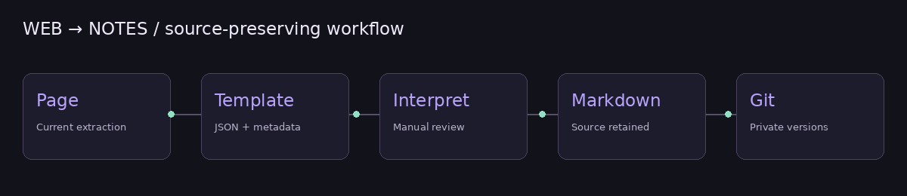

[English (US)](README.md) · [Português (Brasil)](README.pt-BR.md) · [Español (Argentina)](README.es-AR.md) · [Español (México)](README.es-MX.md) · [Español (España)](README.es-ES.md) · [Deutsch](README.de-DE.md) · [Français](README.fr-FR.md)


# Obsidian Web Clipper Toolkit


[Installation](docs/de-DE/install.md) · [Vorlagen](templates/) · [Prompt-Übersicht](docs/de-DE/prompt-map.md) · [Beispiele](examples/) · [Lizenz](LICENSE)

Aktualisiert: 2026-11-18 · 0.1.2 · Private Prüffassung

## Überblick

Wiederverwendbare Web-Clipper-Vorlagen mit manueller Interpretation und erhaltener Quelle.

Portable JSON- und Markdown-Dateien nutzen, Modellvorschläge prüfen, Quellenbelege erhalten und eine Variante ohne KI bereithalten.

## Lieferumfang

| Template | Prompts | Source |
| --- | --- | --- |
| [Balanced](templates/01-balanced-original-callout-clipper.json) | 6 | Callout |
| [Compact](templates/02-compact-original-footer-clipper.json) | 4 | Footer |
| [Archive](templates/03-source-archive-clipper.json) | 0 | Callout |

## Installation

Obsidian und den offiziellen Web Clipper in einem unterstützten Browser installieren. Einen Ordner im Vault anlegen, eine Vorlage importieren und Vault sowie Zielordner prüfen. Automatische Interpretation deaktiviert lassen. Bei KI-Vorlagen Interpret manuell ausführen, Ergebnis prüfen und speichern. Bei Archive Interpreter nicht ausführen.

```powershell
# Windows — project root
py -3 scripts/configure_templates.py --vault "Demo Vault" --folder "clippings"
py -3 scripts/build_site.py
py -3 scripts/validate.py
```

```bash
# macOS / Linux — project root
python3 scripts/configure_templates.py --vault 'Demo Vault' --folder 'clippings'
python3 scripts/build_site.py
python3 scripts/validate.py
```


## Wiederverwendbare Projektvorlage

Die einfachen Metadaten in project-template/Proposal.md bearbeiten und mit new_project.py ein neues leeres Verzeichnis erzeugen. Der Generator erstellt kein Remote-Repository, pusht nicht, veröffentlicht nicht und implementiert keine Anwendung. Namen, E-Mail, URLs und Lizenz vor Veröffentlichung prüfen.

```powershell
py -3 scripts/new_project.py --proposal project-template/Proposal.md --output local-only/new-project
```

```bash
python3 scripts/new_project.py --proposal project-template/Proposal.md --output local-only/new-project
```


## Lokale und entfernte Speicherung

Den vollständigen lokalen Klon und das private Remote behalten. Nach Prüfung committen und pushen; GitHub synchronisiert Dateien nicht automatisch. Ignorierte Einstellungen separat sichern. Doppelte ZIPs und entbehrliche Vorschauen entfernen, nicht Vorlagen oder Skripte.

## Datenschutz

Demodaten verwenden. Lokale Einstellungen, Zugangsdaten, private Notizen und persönliche Pfade ausschließen. Ein privates Repository schützt kein bereits eingechecktes Geheimnis. Der Rechteinhaber hat nur die unten genannte öffentliche Zuordnung genehmigt.

## Validierung und Grenzen

Vorlagenstruktur, Links, Datenschutzmuster, Paket und Seiteninteraktionen werden lokal geprüft. Die früheren isolierten Renderer-Tests für 1.7.1 waren erfolgreich. Reale Provider-Aufrufe, Speichern mit der Erweiterung und vollständige Tests auf Windows, macOS und Linux stehen noch aus.

Der Originalinhalt kann nur Auswahl oder Markierungen enthalten. Der KI-Kontext ist begrenzt. Clipper 1.7.1 kann wörtliche Vorlagenausdrücke in KI-Varianten erneut auswerten; dafür Archive ohne Interpreter verwenden. Automatisches Kopieren zwischen Vaults ist nicht implementiert.

## Lizenz

Quellverfügbare Lizenz für nichtkommerzielle Nutzung. Kommerzielle Nutzung benötigt eine gesonderte Erlaubnis. Weitergegebene geänderte Versionen müssen Quelltext, Urheberhinweise, dieselbe Lizenz und ein datiertes Änderungsprotokoll enthalten. Private Änderungen müssen nicht veröffentlicht werden. Keine OSI-anerkannte Open-Source-Lizenz. Maßgeblich ist die englische LICENSE.

[Projektleitfaden](docs/de-DE/guide.md) · [LICENSE](LICENSE) · [CHANGELOG](CHANGELOG.md)

**Entwickelt von:** Cassio Henrique · Múltipla Tecnologia · [cassiohenriqueofc@gmail.com](mailto:cassiohenriqueofc@gmail.com)

<details>
<summary>Animated workflow / Fluxo animado</summary>



</details>
