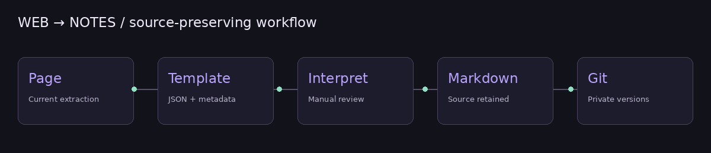

[English (US)](README.md) · [Português (Brasil)](README.pt-BR.md) · [Español (Argentina)](README.es-AR.md) · [Español (México)](README.es-MX.md) · [Español (España)](README.es-ES.md) · [Deutsch](README.de-DE.md) · [Français](README.fr-FR.md)


# Obsidian Web Clipper Toolkit


[Instalación](docs/es-AR/install.md) · [Plantillas](templates/) · [Mapa de prompts](docs/es-AR/prompt-map.md) · [Ejemplos](examples/) · [Licencia](LICENSE)

Actualizado: 2026-11-18 · 0.1.3 · Versión pública · GitHub Pages configurado

## Resumen

Plantillas reutilizables de Web Clipper con interpretación manual y conservación de la fuente.

Usá JSON y Markdown portables, revisá las sugerencias del modelo, conservá la evidencia y mantené una alternativa sin IA.

## Entregas

| Template | Prompts | Source |
| --- | --- | --- |
| [Balanced](templates/01-balanced-original-callout-clipper.json) | 6 | Callout |
| [Compact](templates/02-compact-original-footer-clipper.json) | 4 | Footer |
| [Archive](templates/03-source-archive-clipper.json) | 0 | Callout |

## Instalación

Instalá Obsidian y Web Clipper oficial en un navegador compatible. Creá la carpeta de la bóveda, importá una plantilla y verificá la bóveda y el destino. Dejá desactivada la ejecución automática. Con IA, hacé clic manualmente en Interpret, revisá y guardá. En Archive no ejecutes Interpreter.

```powershell
# Windows — project root
py -3 scripts/configure_templates.py --vault "Demo Vault" --folder "clippings"
py -3 scripts/build_site.py
py -3 scripts/validate.py
```

```bash
# macOS / Linux — project root
python3 scripts/configure_templates.py --vault 'Demo Vault' --folder 'clippings'
python3 scripts/build_site.py
python3 scripts/validate.py
```


## Plantilla reutilizable de proyecto

Editá los metadatos simples de project-template/Proposal.md y generá una carpeta nueva y vacía con new_project.py. El generador no crea repositorios remotos, no hace push, no publica ni implementa la aplicación. Revisá nombres, correo, URL y licencia antes de compartir.

```powershell
py -3 scripts/new_project.py --proposal project-template/Proposal.md --output local-only/new-project
```

```bash
python3 scripts/new_project.py --proposal project-template/Proposal.md --output local-only/new-project
```


## Almacenamiento local y remoto

Conservá el clon local completo y el remoto privado. Hacé commit y push después de revisar; GitHub no sincroniza archivos automáticamente. Respaldá por separado los ajustes excluidos. Para ahorrar espacio, borrá ZIP duplicados y vistas descartables, no fuentes ni scripts.

## Privacidad

Usá datos de demostración. Excluí configuraciones locales, credenciales, notas privadas y rutas personales. Un repositorio privado no protege un secreto ya incorporado al historial. El titular autorizó únicamente la atribución indicada abajo.

## Validación y límites

Se verifican localmente estructura, enlaces, patrones de privacidad, paquete e interacciones del sitio. Pasaron las pruebas aisladas anteriores del renderizador 1.7.1. Faltan proveedor real, guardado desde la extensión y pruebas completas en Windows, macOS y Linux.

El contenido original puede ser una selección o destacados. El contexto de IA tiene límites. Clipper 1.7.1 puede reprocesar expresiones literales en variantes con IA; usá Archive sin Interpreter si afecta la fuente. No hay copia automática entre bóvedas.

## Licencia

Licencia de código disponible para uso no comercial. El uso comercial requiere permiso separado. Las versiones modificadas compartidas deben incluir código correspondiente, atribución, la misma licencia y un registro fechado. No exige publicar cambios privados. No es código abierto aprobado por OSI. La LICENSE inglesa es la válida.

[Guía del proyecto](docs/es-AR/guide.md) · [LICENSE](LICENSE) · [CHANGELOG](CHANGELOG.md)

**Desarrollado por:** Cassio Henrique · Múltipla Tecnologia · [cassiohenriqueofc@gmail.com](mailto:cassiohenriqueofc@gmail.com)

<details>
<summary>Animated workflow / Fluxo animado</summary>



</details>
