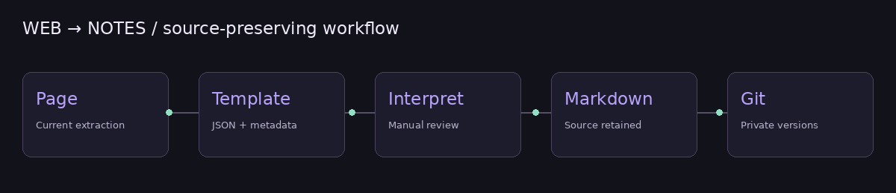

[English (US)](README.md) · [Português (Brasil)](README.pt-BR.md) · [Español (Argentina)](README.es-AR.md) · [Español (México)](README.es-MX.md) · [Español (España)](README.es-ES.md) · [Deutsch](README.de-DE.md) · [Français](README.fr-FR.md)


# Obsidian Web Clipper Toolkit


[Installation](docs/fr-FR/install.md) · [Modèles](templates/) · [Carte des prompts](docs/fr-FR/prompt-map.md) · [Exemples](examples/) · [Licence](LICENSE)

Mis à jour: 2026-11-18 · 0.1.3 · Version publique · GitHub Pages configuré

## Présentation

Modèles Web Clipper réutilisables avec interprétation manuelle et conservation de la source.

Utilisez des fichiers JSON et Markdown portables, vérifiez les suggestions du modèle, conservez les preuves et gardez une solution sans IA.

## Livrables

| Template | Prompts | Source |
| --- | --- | --- |
| [Balanced](templates/01-balanced-original-callout-clipper.json) | 6 | Callout |
| [Compact](templates/02-compact-original-footer-clipper.json) | 4 | Footer |
| [Archive](templates/03-source-archive-clipper.json) | 0 | Callout |

## Installation

Installez Obsidian et Web Clipper officiel dans un navigateur compatible. Créez le dossier du coffre, importez un modèle et vérifiez le coffre et la destination. Désactivez l’exécution automatique. Avec l’IA, lancez Interpret manuellement, vérifiez puis enregistrez. Pour Archive, ne lancez pas Interpreter.

```powershell
# Windows — project root
py -3 scripts/configure_templates.py --vault "Demo Vault" --folder "clippings"
py -3 scripts/build_site.py
py -3 scripts/validate.py
```

```bash
# macOS / Linux — project root
python3 scripts/configure_templates.py --vault 'Demo Vault' --folder 'clippings'
python3 scripts/build_site.py
python3 scripts/validate.py
```


## Modèle de projet réutilisable

Modifiez les métadonnées simples de project-template/Proposal.md puis générez un nouveau dossier vide avec new_project.py. Le générateur ne crée pas de dépôt distant, ne pousse rien, ne publie pas et n’implémente pas l’application. Vérifiez noms, courriel, URL et licence avant diffusion.

```powershell
py -3 scripts/new_project.py --proposal project-template/Proposal.md --output local-only/new-project
```

```bash
python3 scripts/new_project.py --proposal project-template/Proposal.md --output local-only/new-project
```


## Stockage local et distant

Conservez le clone local complet et le dépôt distant privé. Faites commit et push après vérification ; GitHub ne synchronise pas les fichiers automatiquement. Sauvegardez séparément les paramètres ignorés. Supprimez les ZIP en double et les aperçus jetables, pas les sources ni les scripts.

## Confidentialité

Utilisez des données de démonstration. Excluez paramètres locaux, identifiants, notes privées et chemins personnels. Un dépôt privé ne protège pas un secret déjà enregistré dans l’historique. Le titulaire a autorisé uniquement l’attribution indiquée ci-dessous.

## Validation et limites

Structure, liens, motifs de confidentialité, paquet et interactions du site sont vérifiés localement. Les précédents tests isolés du moteur 1.7.1 ont réussi. Les appels réels au fournisseur, l’enregistrement par l’extension et les tests complets Windows, macOS et Linux restent à effectuer.

Le contenu original peut être une sélection ou des passages surlignés. Le contexte IA est limité. Clipper 1.7.1 peut réévaluer des expressions littérales dans les variantes IA ; utilisez Archive sans Interpreter si nécessaire. La copie automatique entre coffres n’est pas implémentée.

## Licence

Licence à code source disponible, réservée à un usage non commercial. L’usage commercial nécessite une autorisation distincte. Les versions modifiées partagées doivent fournir les sources correspondantes, l’attribution, la même licence et un journal daté. Les modifications privées ne doivent pas être publiées. Ce n’est pas une licence open source approuvée par l’OSI. La LICENSE anglaise fait foi.

[Guide du projet](docs/fr-FR/guide.md) · [LICENSE](LICENSE) · [CHANGELOG](CHANGELOG.md)

**Développé par:** Cassio Henrique · Múltipla Tecnologia · [cassiohenriqueofc@gmail.com](mailto:cassiohenriqueofc@gmail.com)

<details>
<summary>Animated workflow / Fluxo animado</summary>



</details>
