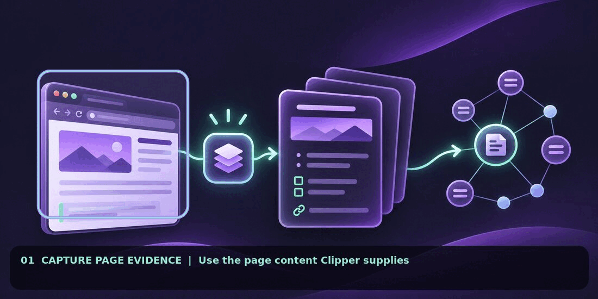

<p align="center">
  <a href="README.md"><strong>English (US)</strong></a> · <a href="README.pt-BR.md">Português (Brasil)</a> · <a href="README.es-AR.md">Español (Argentina)</a> · <a href="README.es-MX.md">Español (México)</a> · <a href="README.es-ES.md">Español (España)</a> · <a href="README.de-DE.md">Deutsch</a> · <a href="README.fr-FR.md">Français</a>
</p>

<p align="center"><a href="templates/">Templates</a> · <a href="docs/en-US/install.md">Install</a> · <a href="docs/en-US/guide.md">Guide</a> · <a href="site/en-US/">Interactive file map</a> · <a href="CHANGELOG.md">Changelog</a></p>

<p align="center">
  
</p>

<h1 align="center">🌐 Obsidian Web Clipper Toolkit</h1>

<p align="center"><strong>Capture the page. Interpret it manually. Keep the source.</strong></p>

<p align="center">  </p>

<p align="center">
  <a href="https://github.com/cassiohenriqueofc/obsidian-web-clipper-toolkit/releases/tag/v0.1.2">Download v0.1.2</a> · <a href="docs/en-US/install.md">Installation guide</a> · <a href="templates/">Browse templates</a> · <a href="docs/en-US/prompt-map.md">Prompt map</a> · <a href="docs/en-US/sources.md">Sources</a>
</p>

<p align="center"><em>Turn a captured page into a reviewed, source-preserving Obsidian note.</em></p>

> [!IMPORTANT]
> This is a community template toolkit for the official Obsidian Web Clipper. It is not the Obsidian extension. Interpreter execution stays manual; generated notes keep the source content supplied by the Clipper.

## What this project does

Import a JSON template, capture a page with [Obsidian Web Clipper](https://obsidian.md/clipper), optionally run its Interpreter yourself, review the result, and save a structured Markdown note. The templates separate source evidence from model-generated explanations and preserve the supplied `{{content}}` in the note.

Use these when you want **Obsidian Web Clipper templates**, **manual AI interpretation**, **source-preserving web capture**, or **structured Markdown notes** without automatic Interpreter execution.

## Choose a template

| Template | Best for | Interpreter prompts | Original content |
| --- | --- | ---: | --- |
| [Balanced](templates/01-balanced-original-callout-clipper.json) | Explanations, research ideas, and a project brief | 6 | Expandable source callout |
| [Compact](templates/02-compact-original-footer-clipper.json) | A shorter analysis with source near the bottom | 4 | Footer section |
| [Archive](templates/03-source-archive-clipper.json) | Deterministic capture without AI | 0 | Source callout |

All generated text is English. Copyable output uses fenced blocks; interactive Obsidian tasks stay outside fences. The archive style does not need a model.

<details open>
<summary>See how page evidence becomes an organized note</summary>



</details>

The static OpenGraph artwork remains in [`assets/social-preview.jpg`](assets/social-preview.jpg); this animation adds a step-by-step explanation for the README and interactive site.

## Quick start

1. Install [Obsidian](https://obsidian.md/download) and the official [Web Clipper](https://obsidian.md/clipper).
2. Create a `clippings` folder in your vault.
3. Import a JSON file from [`templates/`](templates/).
4. Set the vault and folder in the template. Keep automatic Interpreter execution disabled.
5. For the two analysis templates, click **Interpret** manually, review the note, then save it. Do not run Interpreter for Archive.

The supplied content can be a page selection or highlights rather than a complete article. The template retains the `{{content}}` value it receives; the extension, browser, or page may limit what is captured.

### Optional local customization

Run these commands from the project folder with Python 3.10 or newer. The generated files stay in the ignored `local-only/` folder.

```powershell
py -3 scripts/configure_templates.py --vault "My Vault" --folder "clippings"
```

```bash
python3 scripts/configure_templates.py --vault "My Vault" --folder "clippings"
```

Then import the customized files from `local-only/templates/`. See the [Windows, macOS, and Linux instructions](docs/en-US/install.md) for details.

## Browse the project

- [Template comparison](docs/en-US/template-comparison.md) · [Rendered examples](examples/)
- [Reusable project starter](docs/en-US/github-template.md) · [Proposal format](project-template/Proposal.md)
- [Privacy and data handling](docs/en-US/privacy.md) · [License](LICENSE) · [Credits](docs/en-US/sources.md)
- [Search and social metadata review](project/seo-review.md) · [Publication guide](docs/en-US/publishing.md)
- [Current proposal](Proposal.md) · [Release checks](project/release-checks.md) · [Change log](CHANGELOG.md)
- [Seven-language interactive file map](site/en-US/) — local preview; repository files require GitHub access.

## Compatibility and status

The project owner reported Web Clipper 1.7.1 and Obsidian 1.15.1 on Windows. That baseline was used for isolated template-renderer checks, not a complete installed-extension acceptance test. Full save checks on Windows, macOS, and Linux and live Interpreter-provider calls remain unverified.

This is a private review release. No public website is deployed. The site generator stays `noindex` until a real public URL is approved. The custom license prohibits commercial use without separate permission; it is source-available, not OSI-approved open source.

## Help and contributions

Read [CONTRIBUTING.md](CONTRIBUTING.md) before proposing changes. Report security issues using [SECURITY.md](SECURITY.md). Do not commit personal vault paths, settings exports, API keys, or private notes.

**Developed by:** Cassio Henrique · Múltipla Tecnologia · [cassiohenriqueofc@gmail.com](mailto:cassiohenriqueofc@gmail.com)
