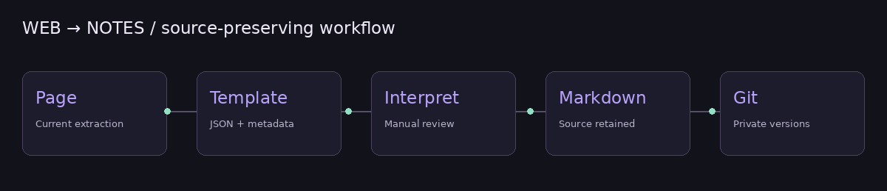

[English (US)](README.md) · [Português (Brasil)](README.pt-BR.md) · [Español (Argentina)](README.es-AR.md) · [Español (México)](README.es-MX.md) · [Español (España)](README.es-ES.md) · [Deutsch](README.de-DE.md) · [Français](README.fr-FR.md)

<p align="right"><a href="README.md">English (US)</a> · <strong>Português (Brasil)</strong></p>


# Obsidian Web Clipper Toolkit

**Capture a web. Interprete com controle. Preserve a fonte.**

| Versão | Atualizado em | Documentação | Idioma dos templates | Licença |
| --- | --- | --- | --- | --- |
| 0.1.3 | 18 de novembro de 2026 | en-US · pt-BR · es-AR · es-MX · es-ES · de-DE · fr-FR | Inglês | Código disponível, uso não comercial |

## Introdução e descrição

Coleção de templates JSON para o Obsidian Web Clipper. Os prompts do Interpreter
geram explicações em Markdown usando os dados fornecidos pela página, enquanto
o conteúdo original extraído continua disponível na nota. Escolha uma captura
detalhada, um formato compacto com fonte no rodapé ou um arquivo sem IA.

Projeto da comunidade, sem vínculo oficial com a Obsidian. A versão 0.1.3 é uma publicação pública; [acesse o site](https://cassiohenriqueofc.github.io/obsidian-web-clipper-toolkit/). O deploy depende da primeira execução bem-sucedida do Actions. As verificações locais passaram; execução real do
provedor, gravação nos três sistemas e renderização no Obsidian ainda precisam
ser verificadas. Referência informada: Web Clipper 1.7.1 e Obsidian 1.15.1 no
Windows. Isso não equivale a um teste completo de compatibilidade.

## Menu

[Vantagens](#por-que-usar) · [Entregas](#entregas) · [Instalação](#instalação-e-uso)
· [Windows, macOS e Linux](docs/pt-BR/install.md) · [Mapa de prompts](docs/pt-BR/prompt-map.md)
· [Ilustração animada](#ilustração-animada) · [Git](docs/pt-BR/development.md)
· [Publicação](docs/pt-BR/publishing.md) · [English](README.md)

## Por que usar

- Preserve a evidência junto da interpretação produzida pela IA.
- Use callouts recolhíveis, conteúdo copiável e tarefas interativas fora das cercas.
- Saiba onde cada prompt atua e quais dados ele recebe.
- Identifique incertezas, inferências e sugestões de pesquisa.
- Mantenha notas Markdown e templates JSON portáveis e versionados.
- Use o modo Archive quando não quiser depender de um modelo.

## Comparação com templates sem Interpreter

| Recurso | Captura apenas com variáveis | Toolkit com Interpreter manual |
| --- | --- | --- |
| Conteúdo e metadados | Extração direta | Extração direta preservada |
| Explicação de conceitos | Texto extraído | Explicação proposta a partir da evidência |
| Próximas ações | Normalmente manuais | Sugestões para revisão |
| Ideias de projeto e pesquisa | Normalmente manuais | Sugestões identificadas, sem rankings inventados |
| Dependências | Sem modelo | Provedor, possível custo e latência |
| Exatidão | Limitações de extração | Limitações de extração e possíveis erros do modelo |

São diferenças de projeto, não resultados de benchmark nem garantia de precisão.

## Entregas

| Ordem¹ | Template | Adequação | Vantagem | Limitação |
| --- | --- | --- | --- | --- |
| 1 | [Balanced](templates/01-balanced-original-callout-clipper.json) | 9/10 | Seis prompts e fonte recolhida | Mais saída de IA |
| 2 | [Compact](templates/02-compact-original-footer-clipper.json) | 8,5/10 | Quatro prompts e fonte no rodapé | Menos seções analíticas |
| 3 | [Archive](templates/03-source-archive-clipper.json) | 8/10 | Sem dependência de IA | Sem análise gerada |

¹Notas editoriais de adequação aos requisitos, não métricas experimentais.

O pacote inclui [proposta](project/proposal-plan.md), [especificação](project/capture-spec.md),
[handoff](handoff.md), exemplos, tutoriais, banner, mapa animado de arquivos,
documentação para SEO e LLMs, scripts de validação/empacotamento e CI.
Exportações pessoais de configurações e os anexos originais não entram no Git.

## Instalação e uso

1. Instale o [Obsidian](https://obsidian.md/download) e o
   [Web Clipper oficial](https://obsidian.md/clipper) em um navegador compatível.
2. Abra um cofre e crie a pasta `clippings`.
3. Importe um JSON em **Configurações do Web Clipper → Templates → Importar**.
4. Substitua o cofre demonstrativo no painel ou gere uma cópia local personalizada.
5. Configure o provedor nas opções da extensão e mantenha a execução automática
   desativada. Nunca coloque chaves neste repositório.
6. Abra uma página, escolha o template, clique manualmente em **Interpret**,
   revise e salve. No Archive, não execute o Interpreter.

```powershell
# Windows, na raiz do projeto; requer Python 3.10+
py -3 scripts/configure_templates.py --vault "Demo Vault" --folder "clippings"
py -3 scripts/validate.py
```

```bash
# macOS ou Linux, na raiz do projeto; requer Python 3.10+
python3 scripts/configure_templates.py --vault "Demo Vault" --folder "clippings"
python3 scripts/validate.py
```

As cópias personalizadas ficam em `local-only/templates/`, uma pasta ignorada
pelo Git. Use uma pasta relativa ao cofre; não informe um caminho absoluto.
O JSON do template não controla sozinho a configuração global de execução manual.
Veja o [tutorial completo por sistema](docs/pt-BR/install.md).

## Ilustração animada

O site estático oferece seletor de idioma, fluxo da captura, mapa animado com
links para cada arquivo da versão e controle para pausar o movimento.
Não utiliza analytics, bibliotecas externas nem chamadas a provedores.

```powershell
py -3 scripts/build_site.py
py -3 -m http.server 8000 --bind 127.0.0.1 --directory site
Start-Process "http://127.0.0.1:8000/pt-BR/"
```

```bash
python3 scripts/build_site.py
python3 -m http.server 8000 --bind 127.0.0.1 --directory site
# Abra http://127.0.0.1:8000/pt-BR/
```

A hospedagem pública **não está ativada**. O visualizador do GitHub não executa
uma página HTML como site. O mapa de arquivos é uma ilustração de relações;
Open Graph é o conjunto separado de metadados para prévias sociais.

## SEO e SEO para LLMs

As páginas têm títulos descritivos, navegação por idioma, dados estruturados
e conteúdo estático. Os arquivos `llms.txt` e `llms-full.txt` ajudam ferramentas
compatíveis a encontrar a documentação; não garantem indexação ou posições.
O site está publicado no GitHub Pages, com URLs canônicas, metadados Open Graph e Twitter, JSON-LD, sitemap e robots indexável. URLs canônicas, alternativas
e de Open Graph absolutas são geradas quando a URL real de publicação for informada.

## Limites importantes

- `content` pode representar somente seleção ou destaques.
- O contexto da IA tem limites; a variável original salva não é truncada.
- O Clipper 1.7.1 pode reprocessar expressões literais de template em capturas
  com IA. Prefira Archive sem Interpreter nessas páginas e confira a fonte.
- Um único prefixo estrutural `>` cria callouts separados, não aninhados.
- Capturas grandes dependem dos limites do navegador, URI e área de transferência.
- Não há cópia automática para outro cofre, pesquisa externa ou verificador de links internos.
- Tipos globais de propriedades podem prevalecer sobre os tipos importados.

## Privacidade, versões e licença

Leia [SECURITY.md](SECURITY.md) e [CONTRIBUTING.md](CONTRIBUTING.md). Valide antes
de cada commit, confira o diff e atualize [CHANGELOG.md](CHANGELOG.md).
Use e-mail noreply do GitHub se quiser ocultar seu endereço pessoal nos commits.

A [licença não comercial](LICENSE) permite estudar, usar, modificar e compartilhar
em situações não comerciais. Versões modificadas compartilhadas devem manter
atribuição, licença, código correspondente e registro datado das alterações.
Não obriga publicar alterações privadas nem cada commit. Não é uma licença
open source aprovada pela OSI. O texto inglês da licença é o válido; há um
[resumo em português](docs/pt-BR/license-summary.md).

## Modelo reutilizável de projeto

Edite o frontmatter simples de project-template/Proposal.md. Gere uma pasta nova e vazia com new_project.py. O gerador não cria remoto, não envia commits, não publica site e não implementa a aplicação. Revise nome, contato, URLs e licença antes de publicar.

```powershell
py -3 scripts/new_project.py --proposal project-template/Proposal.md --output local-only/new-project
```

```bash
python3 scripts/new_project.py --proposal project-template/Proposal.md --output local-only/new-project
```

[Guia do projeto](docs/pt-BR/guide.md) · [aimemory](aimemory/project-defaults.md)

**Desenvolvido por:** Cassio Henrique · Múltipla Tecnologia · [cassiohenriqueofc@gmail.com](mailto:cassiohenriqueofc@gmail.com)

<details>
<summary>Animated workflow / Fluxo animado</summary>



</details>
